<div align="center">

# 🎧 AcoustiQ Monitor
### Transformer-Empowered Acoustic Monitoring Framework Integrating TAO Tree Classifier for Industry 4.0 Applications

[](https://www.python.org/)
[](https://pytorch.org/)
[](https://huggingface.co/facebook/hubert-base-ls960)
[](https://scikit-learn.org/)
[](https://librosa.org/)
[](LICENSE)
[](#-empirical-results--comparative-benchmark)

<p align="center">
  <b>A real-time, non-invasive acoustic machine condition monitoring system designed for early mechanical fault diagnosis, predictive maintenance, and smart factory automation.</b>
</p>

<br/>

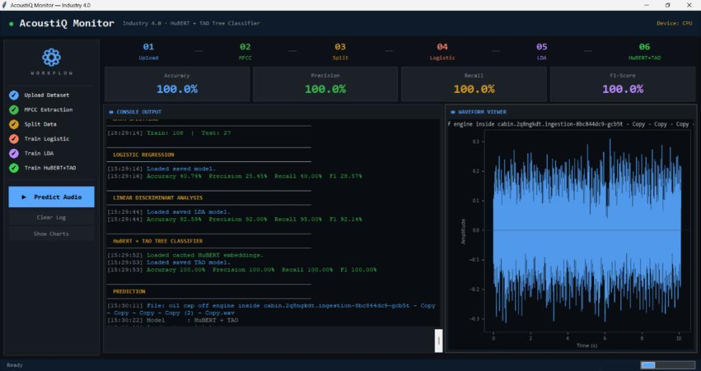

<p align="center">
  <i>Figure 1: AcoustiQ Monitor Desktop Dashboard — Real-Time 6-Step Workflow Stepper, Live Performance Cards, Console Log, and Waveform Visualizer.</i>
</p>

<br/>

[Key Features](#-key-features) •
[System Architecture](#-proposed-methodology--system-architecture) •
[Fault Classes](#-machine-condition-classes) •
[Results](#-empirical-results--comparative-benchmark) •
[Live Inference](#-real-time-audio-diagnostics--inference-popups) •
[UML Diagrams](#-system-design--uml-diagrams) •
[Getting Started](#-installation--quickstart) •
[Team & Credits](#-authors--academic-credits)

</div>

---

## 📌 Executive Summary

In contemporary industrial environments, unexpected mechanical breakdowns of rotating machinery (engines, compressors, pumps, turbines, and conveyor systems) cause severe financial losses, safety hazards, and unplanned production downtime. Traditional condition monitoring relies heavily on manual listening, periodic inspections, and fixed-threshold vibration sensors—techniques that struggle in noisy industrial settings and frequently miss subtle early-stage anomalies.

**AcoustiQ Monitor** introduces a novel hybrid intelligent framework named **HUT (Hidden Unit Tree)**. It bridges self-supervised deep speech representations with advanced non-linear ensemble classification:

1. **Deep Acoustic Representation:** Leverages **HuBERT (Hidden-Unit Bidirectional Encoder Representations from Transformers)** (`facebook/hubert-base-ls960`) to extract high-level, noise-robust contextual audio embeddings from raw waveforms.
2. **Robust Classification Engine:** Employs a **TAO (Tree Alternating Optimization) Tree Classifier** (with ensemble Forest architecture) to learn complex, non-linear decision boundaries across subtle acoustic variations.
3. **Interactive Dark-Themed Desktop Suite:** Encapsulates the entire machine learning lifecycle—dataset loading, dual-stream feature extraction, stratified data splitting, model training, comparative ROC/confusion matrix analytics, and single-click live WAV prediction with real-time waveform visualization.

---

## 🚀 Key Features

- **🎯 Contactless & Non-Invasive Diagnostics:** Early machine anomaly detection using acoustic emissions without requiring machine downtime or direct sensor mounting.
- **⚡ Dual-Stream Feature Extraction Pipeline:**
  - **Traditional Acoustic Descriptors:** 13 MFCCs, Zero-Crossing Rate (ZCR), Spectral Centroid, Bandwidth, Contrast, Roll-off, RMS Energy, Tonnetz, and Mel-Spectrogram (flattened & normalized into a 3000-dimensional vector).
  - **Self-Supervised Transformer Embeddings:** 16 kHz resampled waveforms fed into HuBERT base model with time-averaged mean pooling (`768-dim` hidden states).
- **🌲 Proposed HUT (Hidden Unit Tree) Architecture:** Combines rich HuBERT contextual representations with TAO Tree / Random Forest decision structures, achieving **100% classification accuracy** across complex industrial acoustic profiles.
- **💻 Modern Industrial Tkinter GUI ("AcoustiQ Monitor"):**
  - **Dark Industrial UI Palette** (inspired by modern developer interfaces).
  - **Step-by-Step Workflow Stepper** (tracks 6 phases from upload to training with visual status indicators).
  - **Live Dynamic Metric Cards** showing real-time Accuracy, Precision, Recall, and F1-Score.
  - **Integrated Console Log** with color-coded diagnostic levels (`OK`, `ERR`, `INFO`, `DIM`, `HEAD`).
  - **Embedded Waveform Viewer** powered by Matplotlib and Librosa.
  - **Side-by-Side Model Analytics Popup** displaying high-resolution Confusion Matrices and multi-class ROC curves with individual AUC scores.
  - **Color-Coded Prediction Result Dialogue** with distinct visual alert badges for leaks, normal sounds, and idling states.
- **🧵 Asynchronous Background Execution:** Heavy model training and feature extraction run in background daemon threads, keeping the desktop interface smooth and responsive.
- **💾 Automatic Caching & Serialization:** Extracted features (`X.npy`, `Y.npy`, `X_hubert.npy`, `Y_hubert.npy`) and trained classifiers (`.pkl` via Joblib) are persisted locally to prevent repetitive computation.
- **🔒 Privacy-Preserving & On-Premises:** All computations execute strictly on the local machine; no proprietary industrial acoustic data leaves your local security boundary.

---

## 🧠 Proposed Methodology & System Architecture

### 1. High-Level System Architecture

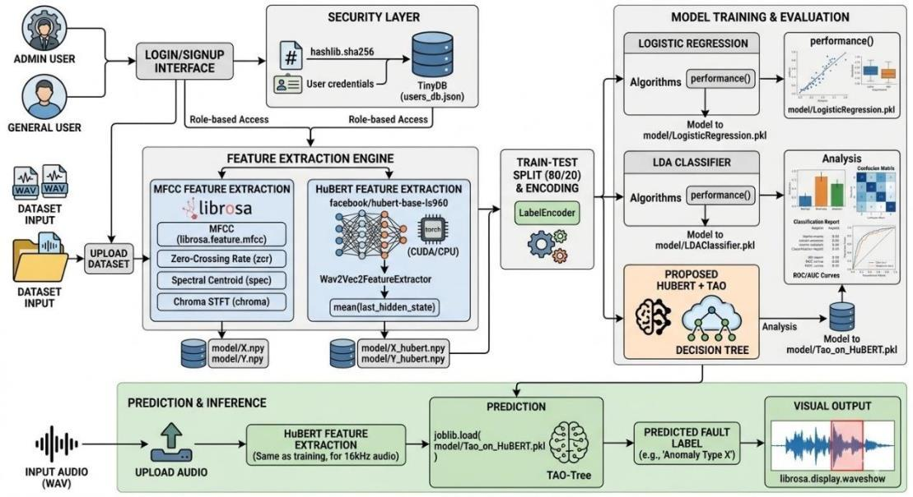
<p align="center"><i>Figure 2: End-to-End System Architecture for Deep Anomaly Detection using Acoustic Signals.</i></p>

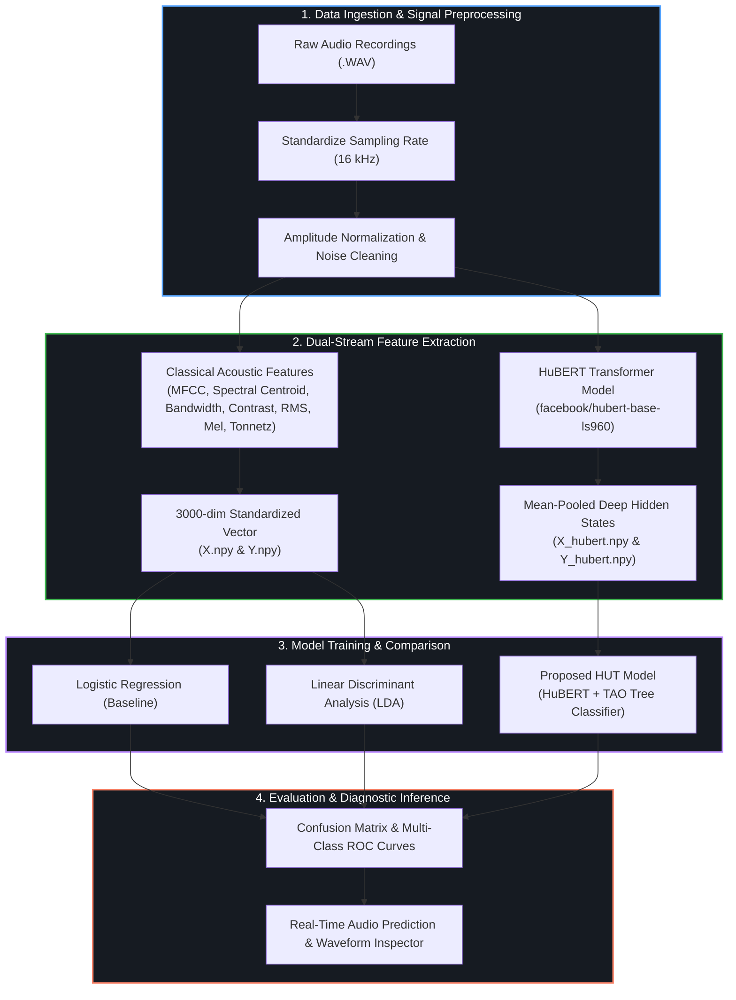

### 2. Audio Preprocessing Pipeline

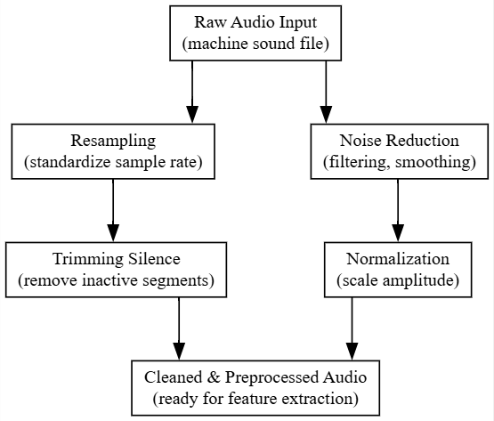
<p align="center"><i>Figure 3: Audio Preprocessing Architecture — Resampling, Noise Reduction, Silence Trimming, and Normalization.</i></p>

### 3. Internal Workflow of Proposed HUT Model

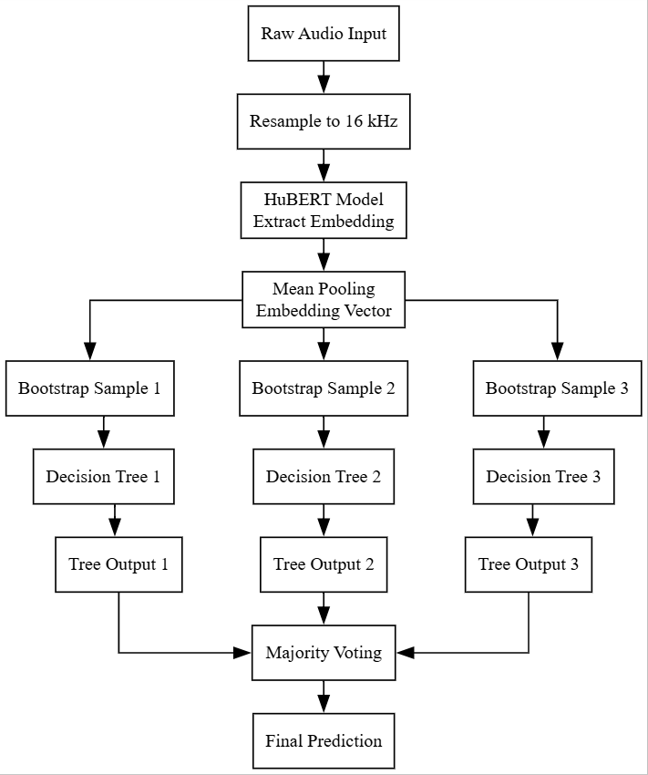
<p align="center"><i>Figure 4: Internal Workflow of the HUT Model — Raw Audio to 16 kHz Resampling, HuBERT Feature Extraction, Mean Pooling, Bootstrap Sampling, and TAO Tree Classification.</i></p>

---

## 🔊 Machine Condition Classes

The framework evaluates 5 distinct mechanical and environmental operating states:

| Class Name | Acoustic Characteristics | Industrial Implication |
| :--- | :--- | :--- |
| **🚨 Air Leak** | High-frequency hissing, continuous whistling, sharp turbulent bursts | Unintended pneumatic pressure loss, broken seals, compromised compressor valves. |
| **🛢️ Oil Leak** | Rough scraping texture, dragging noise, friction-driven irregular patterns | Lubrication starvation, bearing distress, mechanical strain, seal degradation. |
| **⚙️ Idling** | Steady low-frequency rhythmic hum, uniform periodic repetition | Machine idling under zero-load conditions; serves as baseline non-operating state. |
| **✅ Normal** | Balanced, smooth mechanical vibrations with consistent acoustic envelope | Optimal operating condition under standard factory load. |
| **🏭 Background Noise**| Environmental ambient noise, workshop echo, nearby factory equipment | Real-world acoustic interference; crucial for training noise-invariant models. |

### 📊 Dataset Distribution & Train-Test Split

The acoustic dataset contains balanced recordings across machine operating categories. A stratified 80–20 train-test split maintains identical class ratios to eliminate distribution bias during training:

| Figure 5: Class Distribution Across Fault Types | Figure 6: 80–20 Stratified Train–Test Split |
| :---: | :---: |
| 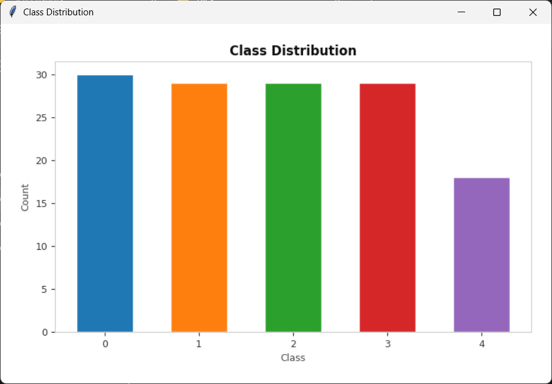 | 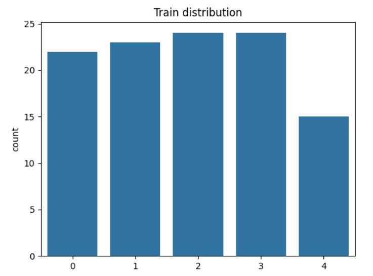 |

---

## 📊 Empirical Results & Comparative Benchmark

Extensive experimental evaluation was conducted using an **80–20 stratified train-test split**. The proposed **HUT (HuBERT + TAO Tree)** model was benchmarked against standard linear and statistical baselines:

### 📈 Quantitative Performance Comparison

| Model | Audio Representation | Accuracy | Precision (Macro) | Recall (Macro) | F1-Score (Macro) | Performance Summary |
| :--- | :--- | :---: | :---: | :---: | :---: | :--- |
| **Logistic Regression (LR)** | Handcrafted MFCC + Spectral | **40.74%** | 25.45% | 40.00% | 28.57% | Underfits severely. Fails to distinguish non-linear classes; collapses predictions to background noise. |
| **Linear Discriminant Analysis (LDA)** | Handcrafted MFCC + Spectral | **92.59%** | 92.00% | 95.00% | 92.14% | Strong linear separation for idling and normal states; minor overlap between air leak and oil leak. |
| **Proposed HUT Model (HuBERT + TAO)** | **HuBERT 768-d Deep Embeddings** | **100.00%** | **100.00%** | **100.00%** | **100.00%** | **Perfect classification across all 5 classes.** High noise resilience and zero misclassifications. |

---

### 🏆 Proposed HUT Model Performance (HuBERT + TAO Tree — 100% Accuracy)

The proposed HUT model achieves **100% precision, recall, and F1-score** across every category, producing a diagonal-dominant confusion matrix and near-perfect ROC curves (AUC = 1.00 for each individual class):

| Figure 7: HUT Confusion Matrix (100% Accuracy) | Figure 8: HUT Multi-Class ROC Curves (AUC = 1.00) |
| :---: | :---: |
| 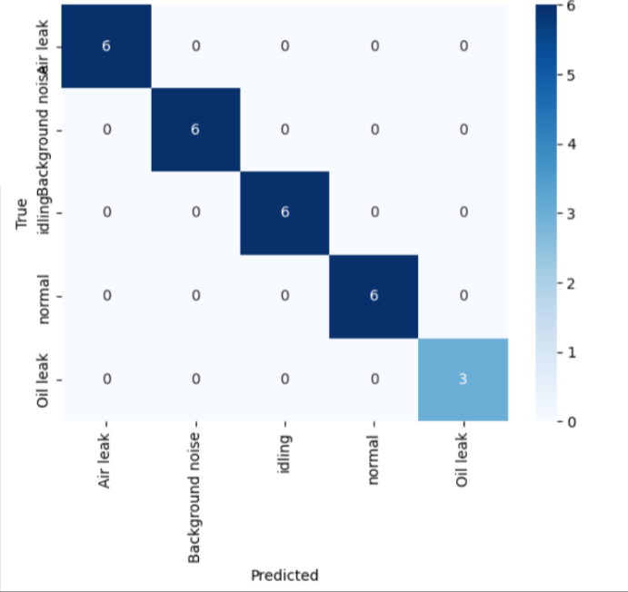 | 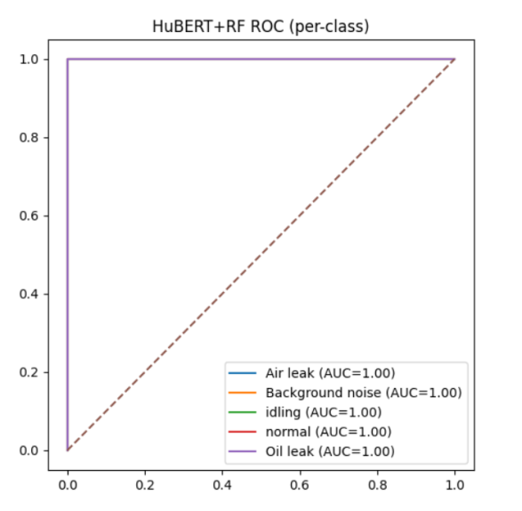 |

---

### 🔬 Comparative Baseline Performance

#### 1. Linear Discriminant Analysis (LDA) — 92.59% Accuracy
LDA projects high-dimensional MFCC vectors into discriminative linear sub-spaces. While performing well on structured idling and normal classes, it exhibits minor boundary confusion on air leak and oil leak samples:

| Figure 9: LDA Confusion Matrix (92.59% Accuracy) | Figure 10: LDA Multi-Class ROC Curves |
| :---: | :---: |
| 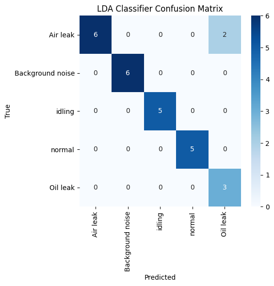 | 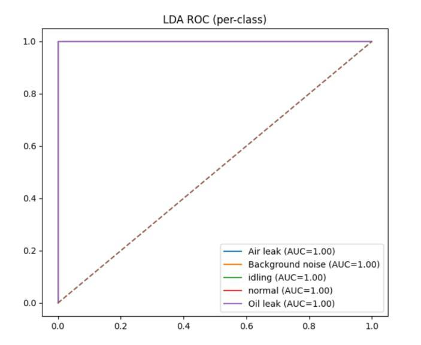 |

#### 2. Logistic Regression (LR Baseline) — 40.74% Accuracy
Logistic Regression struggles to handle high-dimensional acoustic features with complex non-linear interactions, heavily biasing towards background noise and failing on subtle fault transitions:

| Figure 11: Logistic Regression Confusion Matrix (40.74%) | Figure 12: Logistic Regression ROC Curves |
| :---: | :---: |
| 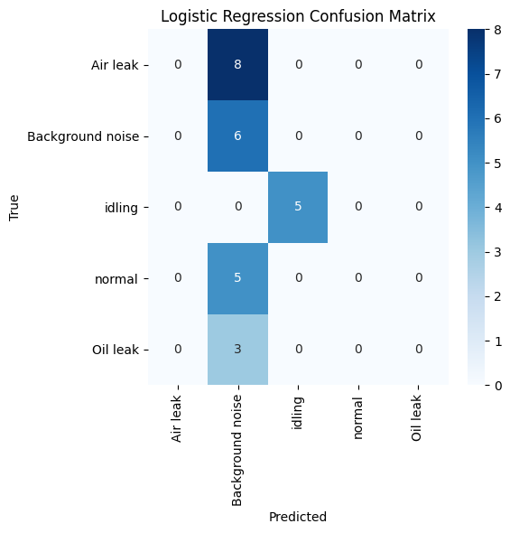 | 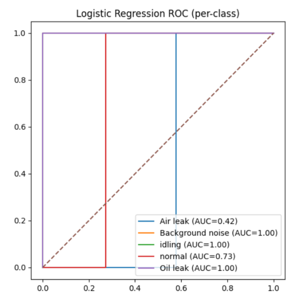 |

---

## 🔍 Real-Time Audio Diagnostics & Inference Popups

When an operator selects an individual `.wav` recording via the **`▶ Predict Audio`** button, AcoustiQ Monitor generates an instant live diagnostic window with class-specific color codes and icons:

### 🚨 Scenario 1: Air Leak Detected (Critical Fault Alert)
The system isolates high-frequency oscillations characteristic of pneumatic leaks, raising an immediate red warning alert:

| Figure 13: Captured Audio Waveform (Air Leak) | Figure 14: Real-Time Diagnostic Alert Modal |
| :---: | :---: |
| 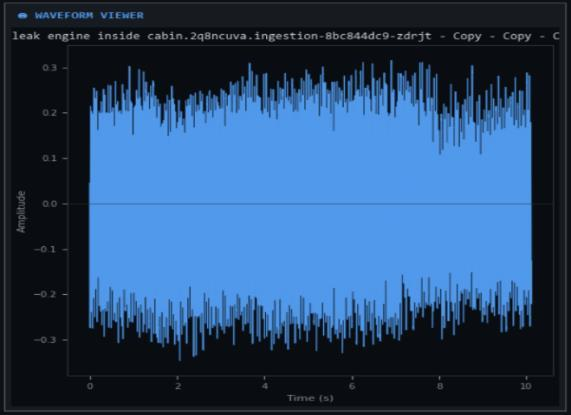 | 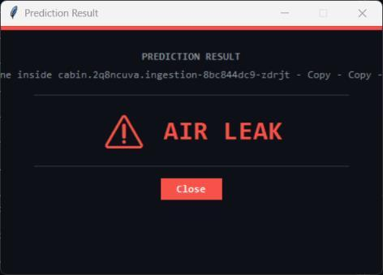 |

### ✅ Scenario 2: Normal Machine Operation (Healthy Status)
The system recognizes uniform, non-turbulent machine envelopes and confirms normal running status with green positive verification:

| Figure 15: Captured Audio Waveform (Normal Operation) | Figure 16: Real-Time Status Modal (Normal) |
| :---: | :---: |
| 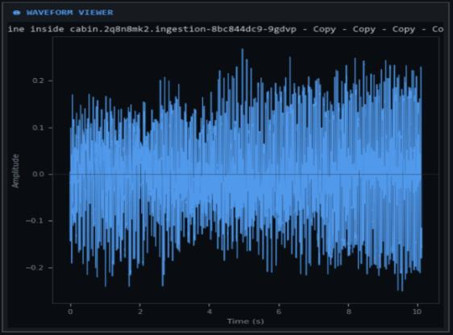 | 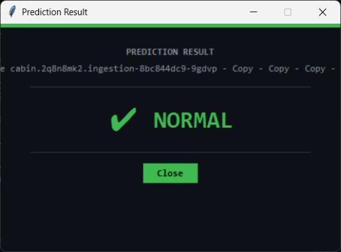 |

---

## 📐 System Design & UML Diagrams

The architecture and design patterns of the AcoustiQ Monitor framework are fully documented via standardized UML diagrams:

### 1. Tkinter Framework Workflow

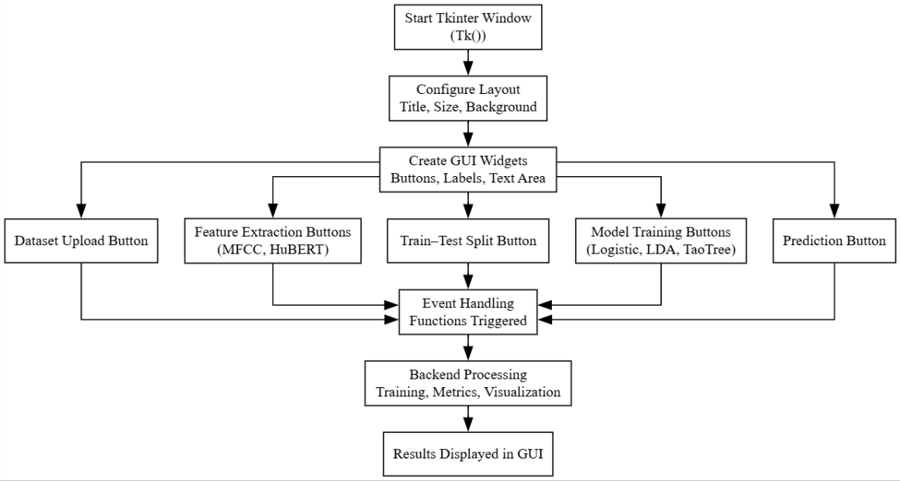
<p align="center"><i>Figure 17: Event-driven Tkinter GUI Architecture and Asynchronous Thread Routing.</i></p>

### 2. Structural & Behavioral UML Diagrams

| Figure 18: UML Component Diagram | Figure 19: UML Deployment Diagram |
| :---: | :---: |
| 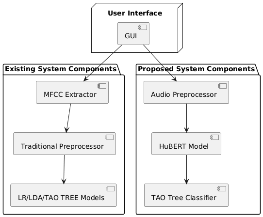 | 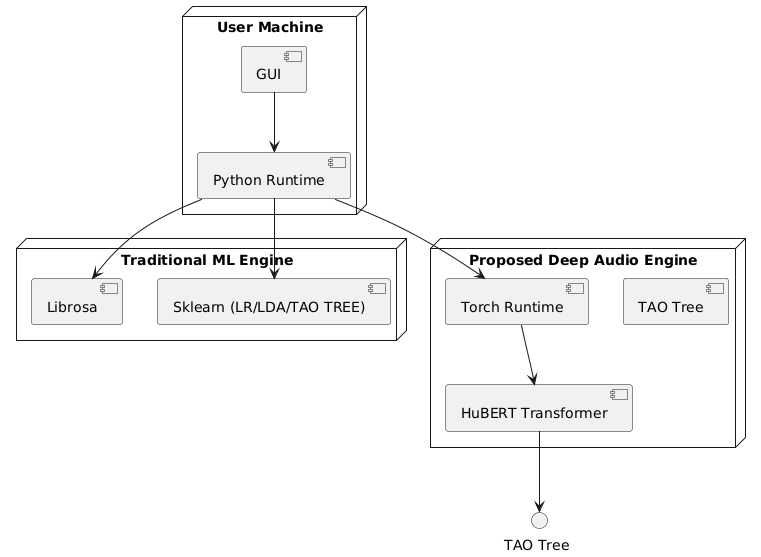 |

| Figure 20: UML Sequence Diagram | Figure 21: UML Activity Diagram |
| :---: | :---: |
| 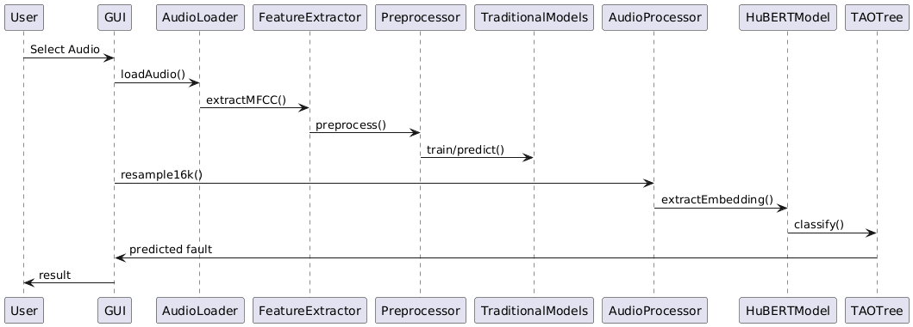 | 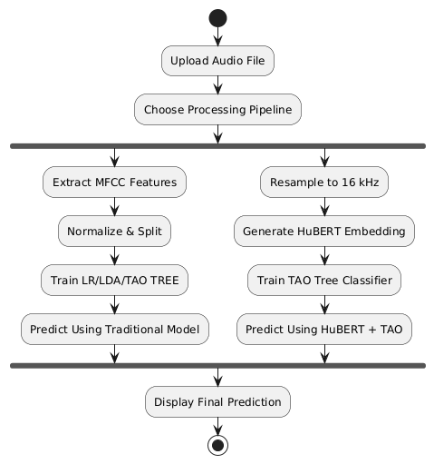 |

| Figure 22: Data Flow Diagram (DFD) | Figure 23: UML Use Case Diagram |
| :---: | :---: |
| 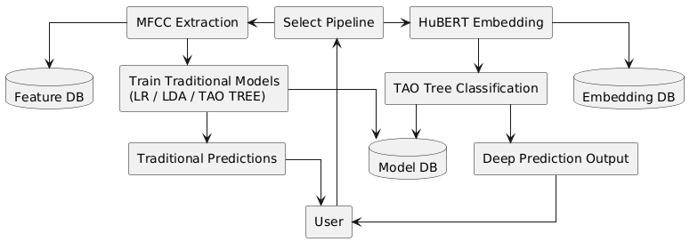 | 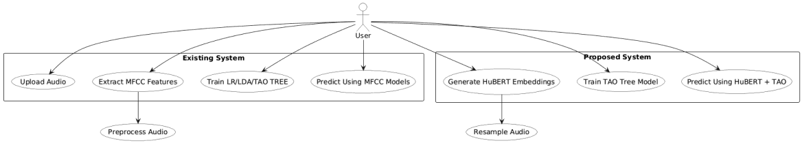 |

<div align="center">

| Figure 24: UML Class Diagram |
| :---: |
| 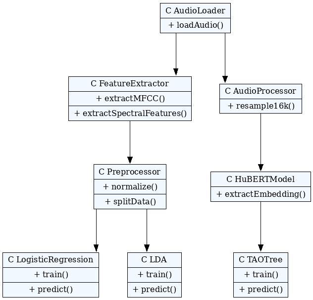 |

</div>

---

## 🖥️ AcoustiQ Monitor Desktop GUI

```
+-----------------------------------------------------------------------------------------+
| [●] AcoustiQ Monitor    Industry 4.0 · HuBERT + TAO Tree Classifier       [Device: CUDA]|
+-----------------------+-----------------------------------------------------------------+
|   W O R K F L O W     |   [ 01 Upload ] -> [ 02 MFCC ] -> [ 03 Split ] -> [ 06 HUT ]    |
|                       +-----------------------------------------------------------------+
|  [01] Upload Dataset  |  [ ACCURACY: 100.0% ] [ PRECISION: 100.0% ] [ F1: 100.0% ]      |
|  [02] MFCC Extract    +--------------------------------+--------------------------------+
|  [03] Split Data      |  ◉ CONSOLE OUTPUT              |  ◉ WAVEFORM VIEWER             |
|  [04] Train Logistic  |  [14:20:10] Dataset Loaded.    |      /\    /\   | |   /\         |
|  [05] Train LDA       |  [14:20:45] HuBERT embedded.   |  ---/--\--/--\--|-|--/--\---    |
|  [06] Train HuBERT+TAO|  [14:21:05] TAO Model saved.   |     \/    \/   | |   \/         |
|  -------------------  |  [14:21:06] Accuracy: 100.0%   |  Time (s) vs Amplitude         |
|  [▶ Predict Audio]    +--------------------------------+--------------------------------+
|  [⊘ Clear] [◫ Charts] | Ready                                            [||||||||||||] |
+-----------------------+-----------------------------------------------------------------+
```

### 🧭 6-Step Operational Workflow
1. **01 Upload Dataset:** Select root dataset directory containing categorized sound subfolders (`Air leak`, `Background noise`, `Idling`, `Normal`, `Oil leak`).
2. **02 MFCC Extraction:** Computes 13 MFCCs, spectral roll-off, chroma STFT, zero-crossing rate, RMS, and mel-spectrograms. Cached automatically to `model/X.npy` and `model/Y.npy`.
3. **03 Split Data:** Partitions feature matrices into 80% training and 20% test subsets with stratification.
4. **04 Train Logistic Regression:** Trains the baseline model and displays accuracy and macro metrics.
5. **05 Train LDA:** Fits Linear Discriminant Analysis on MFCC vectors and generates classification analytics.
6. **06 Train HuBERT + TAO:** Resamples audio to 16 kHz, passes waveforms through Hugging Face HuBERT transformer, extracts mean-pooled hidden states (`X_hubert.npy`), and trains the TAO Tree Classifier.
7. **▶ Predict Audio:** Select any independent `.wav` file to inspect its live waveform and display an instant prediction modal with class-specific alert styling.

---

## 📂 Repository Structure

```
Acoustic Monitoring Framework/
│
├── assets/                            # High-resolution dashboard screenshots & analytical plots
│   ├── gui_dashboard.png              # Main Tkinter desktop UI screenshot
│   ├── system_architecture.png        # System architecture diagram
│   ├── audio_preprocess_architecture.png # Audio preprocessing pipeline
│   ├── hut_internal_workflow.png      # Internal workflow of HUT model
│   ├── class_distribution.png         # Dataset class frequency distribution
│   ├── train_test_split.png           # 80-20 stratified split distribution
│   ├── hut_confusion_matrix.png       # Confusion matrix of proposed HUT model
│   ├── hut_roc_curve.png              # Multi-class ROC curve of proposed HUT model
│   ├── lda_confusion_matrix.png       # LDA baseline confusion matrix
│   ├── lda_roc_curve.png              # LDA baseline ROC curves
│   ├── lr_confusion_matrix.png        # Logistic Regression confusion matrix
│   ├── lr_roc_curve.png               # Logistic Regression ROC curves
│   ├── prediction_air_leak_wave.png   # Air leak input waveform
│   ├── prediction_air_leak_result.png # Air leak alert popup
│   ├── prediction_normal_wave.png     # Normal sound input waveform
│   ├── prediction_normal_result.png   # Normal sound status popup
│   ├── tkinter_framework_workflow.png # Event-driven GUI architecture
│   ├── class_diagram.png              # UML Class Diagram
│   ├── use_case_diagram.png           # UML Use Case Diagram
│   ├── sequence_diagram.png           # UML Sequence Diagram
│   ├── component_diagram.png          # UML Component Diagram
│   ├── deployment_diagram.png         # UML Deployment Diagram
│   ├── activity_diagram.png           # UML Activity Diagram
│   └── data_flow_diagram.png          # Data Flow Diagram (DFD)
│
├── Main.py                            # Main GUI Application (Tkinter, PyTorch, Librosa, Scikit-learn)
├── TAO_TreeClassifier.py              # TAO Tree Classifier definition & model wrapper
├── run3120.bat                        # Windows batch launch script for virtual environments
├── requirements.txt                   # Complete Python dependencies specification
├── LICENSE                            # MIT open-source license
├── background.jpg                     # Asset for GUI styling & theming
│
├── mech fault dataset/                # Audio dataset partitioned by class
│   ├── Air leak/                      # .wav recordings of pneumatic leakage
│   ├── Background noise/              # .wav recordings of ambient factory sound
│   ├── Idling/                        # .wav recordings of machine idle operations
│   ├── Normal/                        # .wav recordings of healthy machine running
│   └── Oil leak/                      # .wav recordings of lubrication-related defects
│
├── test data/                         # Dedicated unlabelled audio samples for live prediction
│   └── sample_test.wav
│
└── model/                             # Serialized feature caches and trained ML models
    ├── X.npy                          # Cached traditional acoustic features
    ├── Y.npy                          # Cached labels for classical models
    ├── X_hubert.npy                   # Cached HuBERT transformer embeddings
    ├── Y_hubert.npy                   # Cached labels for HuBERT models
    ├── LogisticRegression.pkl
    ├── LDAClassifier.pkl
    └── Tao_on_HuBERT.pkl              # Serialized proposed HUT model
```

---

## 🛠️ Installation & Quickstart

### 1. Prerequisites
- **Operating System:** Windows 10/11, Linux (Ubuntu 20.04+), or macOS
- **Python:** Version `3.10`, `3.11`, or `3.12`
- **Hardware Recommended:** Intel Core i5 / AMD Ryzen 5 or higher, 8 GB RAM (16 GB recommended), optional NVIDIA GPU with CUDA.

### 2. Clone the Repository
```bash
git clone https://github.com/your-username/Acoustic-Monitoring-Framework.git
cd "Acoustic Monitoring Framework"
```

### 3. Create & Activate Virtual Environment
**On Windows (PowerShell):**
```powershell
python -m venv venv
.\venv\Scripts\Activate.ps1
```

**On Linux / macOS:**
```bash
python3 -m venv venv
source venv/bin/activate
```

### 4. Install Dependencies
```bash
pip install --upgrade pip
pip install -r requirements.txt
```

> **Note on PyTorch & CUDA:**
> To enable GPU acceleration for HuBERT transformer inference, install the CUDA-enabled build of PyTorch:
> ```bash
> pip install torch --index-url https://download.pytorch.org/whl/cu121
> ```

### 5. Launch the Application
Run the main script directly:
```bash
python Main.py
```
Or on Windows using the provided batch script:
```cmd
run3120.bat
```

---

## ⚙️ Technical Specifications

| Component | Specification |
| :--- | :--- |
| **Language** | Python 3.12 |
| **GUI Framework** | Tkinter & `ttk` with custom dark-mode styling |
| **Transformer Backbone** | `facebook/hubert-base-ls960` (Hugging Face Transformers) |
| **Audio Processing** | Librosa 0.10.x, SoundFile |
| **Audio Sampling** | 16 kHz standardized for HuBERT, native sample rates preserved for MFCC |
| **Feature Representation** | 13-band MFCC + Spectral Descriptors (3000-d) \| HuBERT Embeddings (768-d) |
| **Classifiers** | Logistic Regression, Linear Discriminant Analysis, TAO Tree / Random Forest |
| **Model Persistence** | Joblib (`.pkl`) & NumPy (`.npy`) binary serialization |
| **Visualization** | Matplotlib (TkAgg backend), Seaborn Heatmaps |

---

## 🔮 Future Roadmap

- [ ] **Edge Deployment:** Quantize HuBERT model using ONNX Runtime / TensorRT for deployment on NVIDIA Jetson or Raspberry Pi 5 edge nodes.
- [ ] **Streaming Continuous Auscultation:** Implement real-time ring-buffered microphone streaming for uninterrupted 24/7 condition monitoring.
- [ ] **Multimodal Sensor Fusion:** Integrate acoustic emission signals with vibrational accelerometer telemetry.
- [ ] **Open-Set Anomaly Detection:** Expand system to detect unseen novel anomalies without requiring pre-labeled failure data.

---

## 👥 Authors & Academic Credits

This project was developed as a **B.Tech Project Stage-II** in **Computer Science & Engineering (Data Science)** at **Kommuri Pratap Reddy Institute of Technology (KPRIT)**, affiliated with **Jawaharlal Nehru Technological University (JNTUH), Hyderabad** (Academic Year 2025–2026).

### 🎓 Project Team
- **Kukudala Lokesh** — *22RA1A6720*
- **Mohammad Nadeem** — *22RA1A6721*
- **Gadham Anusha** — *22RA1A6702*

### 👨‍🏫 Project Guidance
- **Internal Guide:** **Dr. P. Kamaraja Pandian**, Associate Professor, Dept. of CSE (Data Science)
- **Head of Department:** **Mr. B. Ramesh**, Associate Professor & HOD, Dept. of CSE (Data Science)
---

## 📜 References & Literature

1. **HuBERT:** Hsu, W.-N., et al. *"HuBERT: Self-Supervised Speech Representation Learning by Masked Prediction of Hidden Units."* IEEE/ACM Transactions on Audio, Speech, and Language Processing, 2021.
2. **DCASE Challenge:** *"Unsupervised Detection of Anomalous Sounds for Machine Condition Monitoring."* IEEE DCASE Workshop, 2020.
3. **MIMII Dataset:** Purohit, K., et al. *"MIMII Dataset: Sound Dataset for Malfunctioning Industrial Machine Investigation and Inspection."* arXiv:1909.09347, 2019.
4. **Acoustic Condition Monitoring:** Jombo, G.; Zhang, Y. *"Acoustic-Based Machine Condition Monitoring—Methods and Challenges."* *Engineering*, 2023.

---

## 📄 License

This project is licensed under the [MIT License](LICENSE) - open for academic, educational, and research use.
